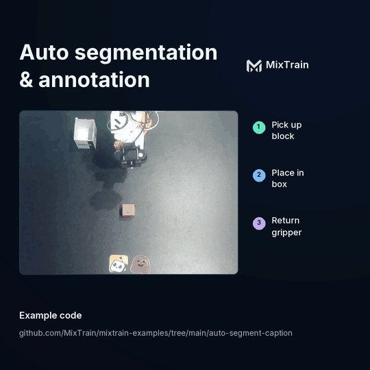

# Auto Segment & Caption <a href="https://app.mixtrain.ai/new?from=https%3A%2F%2Fgithub.com%2FMixTrain%2Fmixtrain-examples%2Ftree%2Fmain%2Fauto-segment-caption&amp;type=workflow&amp;exclude=assets"></a>

Turn raw video into timestamped, captioned actions. Give the workflow a robot
demonstration or an egocentric video. It finds where each action starts and
ends, and writes a short caption for each one.

<p align="center">
  
</p>

This is the labeling step in many training data pipelines. Action captions let
you train language-conditioned policies and VLMs, search a large video corpus,
and split long recordings into clean episodes. The models are NVIDIA's
[FLORA](https://research.nvidia.com/labs/gear/flora/) segmenter and captioner.

## What you'll learn

- How to run a large video model as a workflow with a custom Dockerfile
- How to pass `Video` inputs from a public URL or workspace storage
- How to process one episode out of a long recording

## How it works

```
video ──trim to [start_s, end_s)──▶ FLORA segmenter ──▶ action intervals
                                                              │
                                     FLORA captioner ◀────────┘
                                            │
                                            ▼
                     [{start_s, end_s, caption}, ...]
```

The segmenter finds action boundaries, and the captioner describes each
interval. Timestamps are in seconds from the start of the trimmed clip.

## Prerequisites

- [mixtrain CLI installed and logged in](https://mixtrain.ai/docs/guide/quickstart)

## Run it

Create the workflow from this directory:

```bash
mixtrain workflow create . --name auto-segment-caption
```

Caption the first episode of LeRobot's
[SO-100 pick-and-place dataset](https://huggingface.co/datasets/lerobot/svla_so100_pickplace).
The dataset stores all 50 episodes in one video file, so `end_s` cuts out
episode 0:

```bash
mixtrain workflow run auto-segment-caption --input-json '{
  "video": "https://huggingface.co/datasets/lerobot/svla_so100_pickplace/resolve/728583b5eaf9e739a7f119e2def466fa1d552402/videos/observation.images.top/chunk-000/file-000.mp4",
  "end_s": 15.133333,
  "profile": "yam"
}'
```

The first run builds the image and downloads the model weights, which takes a
while. Both are cached for later runs. Each run still spends about 10 minutes
loading and verifying weights; captioning a clip takes well under a minute.

The run returns one entry per action:

| Start | End | Caption |
| --- | --- | --- |
| 0.00 s | 6.50 s | Pick up the red block from the table with the right hand. |
| 6.50 s | 11.00 s | Put the red block into the white box with the right hand. |
| 11.00 s | 15.13 s | Move the robotic hand back to the center of the table. |

[`example_output.json`](example_output.json) has the full output, including
model revisions. Captions are the model's raw output; here it calls the robot
gripper a "right hand".

## Use your own video

Pass any public URL, cloud storage URL (`gs://`, `s3://`), or workspace path.
To upload a local file and run on it from Python:

```python
from mixtrain import Video, Workflow

video = Video.from_file("demo.mp4").save()
result = Workflow("auto-segment-caption").run(video=video, profile="human")
for segment in result.output["segments"]:
    print(f"{segment['start_s']:6.2f}–{segment['end_s']:6.2f}s  {segment['caption']}")
```

## Inputs

- `video`: main camera video (required)
- `start_s`, `end_s`: the part of the video to process, in seconds. Defaults to the whole video.
- `profile`: `human` for egocentric or third-person human video (default), or a
  robot layout: `yam`, `dex`, or `tianji`
- `instruction`: optional task description, such as `"Put the cube in the box."`, to guide the captions
- `left_wrist`, `right_wrist`: optional wrist cameras, synchronized with `video`. Pass both or neither.
- `yam32`: use FLORA's 32-second, three-camera YAM layout. Requires both wrist cameras.
- `include_audit`: include the pipeline's intermediate segmentation records

## Extend it

- **Label a whole dataset.** Call the workflow once per episode from a
  [routine](https://mixtrain.ai/docs/guide/routines) or a parent workflow, as
  [`parameter-sweep`](../parameter-sweep/) does. Write the segments back as a
  dataset column.
- **Filter before training.** Drop episodes with empty or repeated captions, or
  keep only the episodes whose captions match the task you want to train.

## License

FLORA weights are for noncommercial research and development under the
[NVIDIA model terms](https://huggingface.co/nvidia/Flora-TempSeg#licenseterms-of-use).

## Learn more

- [Workflows guide](https://mixtrain.ai/docs/guide/workflows)
- [Input/Output types](https://mixtrain.ai/docs/guide/types)
- [FLORA project page](https://research.nvidia.com/labs/gear/flora/)
